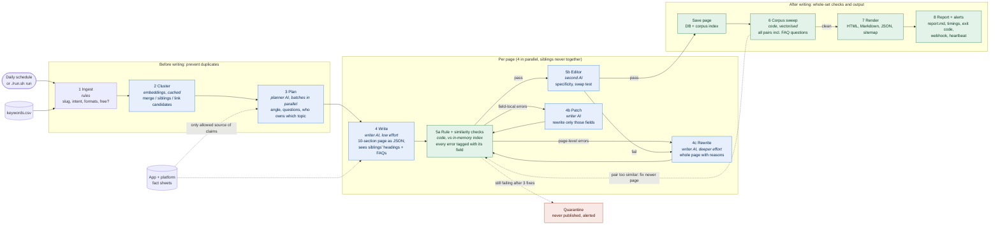
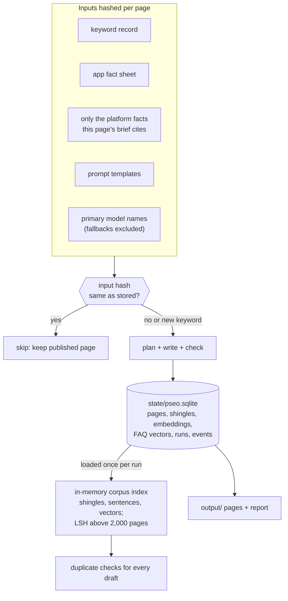
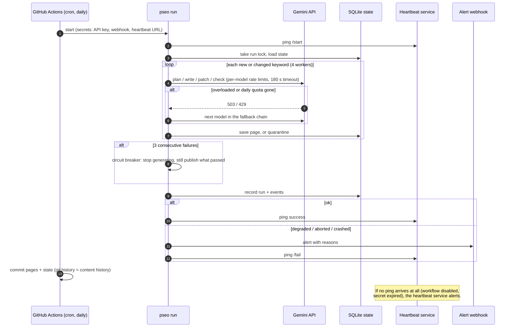

# Architecture

Three views of the same system. GitHub renders these diagrams directly. To trace one real page through it in a terminal, run `./run.sh explain convert-scanned-image-to-text`.

## 1. The pipeline and the agent loop

The main line runs left to right. The red paths are the agent behaviour: a draft that fails a check goes back with the exact reasons, routed by kind. Errors confined to one or two fields (an FAQ question, the meta description, a banned word) go to a **patch** that rewrites only those fields; page-level problems (too close in meaning to another page, editor rejection) go to a full **rewrite**. After 3 fixes a page is quarantined instead of published. Up to 4 pages run through the loop at once; a scheduler never runs two pages that share territory at the same time.

### Why these routes

| Pattern | Where | Why |
|---|---|---|
| Parallelization | sibling-aware scheduler (`pipeline._schedule`) | pages are independent except siblings, which must see each other's final text |
| Routing | patch vs rewrite (`QAResult.fix_fields`, `page_level`) | a duplicated FAQ shouldn't cost a whole new page, or risk breaking sections that already passed |
| Evaluator-optimizer | gates + editor feed specific reasons back | the writer gets "FAQ 3 repeats /ocr-handwriting-iphone", not "try again" |
| Prevention | sibling headings + FAQs in the writer prompt | cheaper to avoid an overlap than to detect and repair it |

## 2. What the pipeline remembers between runs (incremental runs)

Each page stores a hash of everything that determines its content. A run regenerates only the pages whose hash changed, which is why a run with no changes reports "0 pages to generate".

Editing one fact in `data/platform_facts.yaml` regenerates only the pages whose brief cites that fact. Removing a keyword marks its page `retired`, which drops it from the output and the sitemap.

## 3. Running unattended

## Where each box lives in the code

| Box | File |
|---|---|
| Ingest | `src/pseo/keywords.py` |
| Cluster | `src/pseo/cluster.py` |
| Plan, Write, Patch, Editor | `src/pseo/agents.py` + `prompts/` |
| Rule + similarity checks | `src/pseo/quality.py`, `src/pseo/similarity.py` |
| Corpus index | `src/pseo/index.py` |
| Scheduler, patch/rewrite loop, sweep, circuit breaker, hashing | `src/pseo/pipeline.py` |
| Render | `src/pseo/render.py` + `templates/` |
| Report | `src/pseo/report.py` |
| State | `src/pseo/store.py` |
| Retries, timeouts, model fallback | `src/pseo/llm.py` |
| Lock, alerts, heartbeat | `src/pseo/ops.py` |
| Schedule | `.github/workflows/pseo.yml` |
